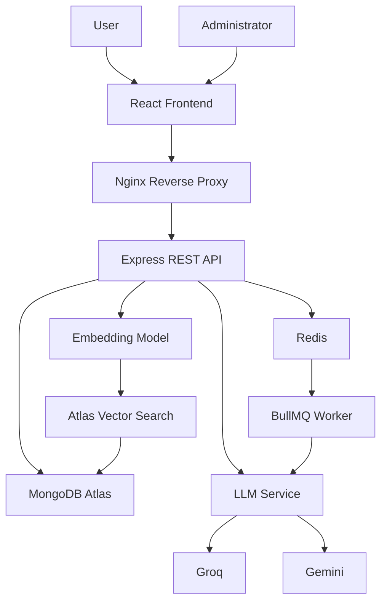

# CareerLens AI

### AI-Powered Career Intelligence & Resume Optimization Platform

[](https://ai-resume-analyzer-gtwt.vercel.app/)

CareerLens AI is a full-stack, AI-powered career development platform designed to help students and professionals analyze resumes, identify skill gaps, prepare for interviews, and build personalized career development strategies.

## Key Features

- AI-powered resume analysis and optimization
- ATS-oriented resume evaluation
- RAG-based conversational career assistant
- Semantic search using vector embeddings
- Intelligent job matching
- Skill gap identification
- Personalized career roadmaps
- AI-powered career agents
- Mock interview generation and evaluation
- Interview performance reports
- Background AI job processing
- Administrative analytics dashboard
- AI usage monitoring and daily quotas
- Multi-factor authentication for administrators
- User management and administrative audit logs

## Technology Stack

| Layer | Technologies |
|---|---|
| Frontend | React.js, TypeScript, Vite |
| Backend | Node.js, Express.js, TypeScript |
| Database | MongoDB Atlas |
| Vector Search | MongoDB Atlas Vector Search |
| AI Providers | Groq, Google Gemini |
| Embeddings | Hugging Face Transformers, MiniLM |
| Caching and Quotas | Redis |
| Background Processing | BullMQ |
| Authentication | JWT, bcrypt, TOTP MFA |
| Validation | Zod |
| Containerization | Docker, Docker Compose |
| Testing | Vitest |

## System Architecture



## RAG Pipeline

1. Validate and sanitize the user's question.
2. Generate a 384-dimensional query embedding.
3. Retrieve relevant resume chunks using semantic vector search.
4. Construct a context-grounded prompt.
5. Enforce AI usage quotas.
6. Generate a structured AI response.
7. Validate response structure and supporting citations.
8. Attempt correction when generated citations are invalid.
9. Return and store the verified response.

## Security

- JWT-based authentication
- Role-based access control
- Administrator TOTP multi-factor authentication
- Administrator session revocation
- Account suspension and session invalidation
- Distributed rate limiting
- Redis-backed AI usage quotas
- Input validation and sanitization
- Personal information redaction
- Prompt injection safeguards
- Administrative audit logging
- Non-root Docker containers
- Environment-based secret management

## Project Structure

```text
CareerLens-AI/
├── backend/
│   ├── src/
│   │   ├── config/
│   │   ├── controllers/
│   │   ├── middleware/
│   │   ├── models/
│   │   ├── prompts/
│   │   ├── routes/
│   │   ├── services/
│   │   ├── utils/
│   │   ├── validators/
│   │   └── workers/
│   ├── tests/
│   ├── Dockerfile
│   └── package.json
├── frontend/
│   ├── src/
│   ├── Dockerfile
│   └── package.json
├── docker-compose.yml
├── DEPLOYMENT.md
├── .env.production.example
└── README.md
```

## Getting Started

### Prerequisites

- Node.js
- npm
- Docker and Docker Compose
- MongoDB Atlas account
- Supported AI provider API keys

### Environment Configuration

Configure the root and backend environment files using the provided example files and deployment documentation.

Never commit actual environment files, passwords, API keys or private credentials.

Configure MongoDB Atlas Vector Search before using the RAG assistant.

### Run Using Docker

```bash
git clone https://github.com/Anshu2607/AI-Resume-Analyzer.git
cd AI-Resume-Analyzer
```

After configuring the required environment variables:

```bash
docker compose build
docker compose up -d
```

Open the application:

```text
http://localhost:3000
```

### Run Backend Tests

```bash
cd backend
npm ci
npm run test
```

### Build Frontend

```bash
