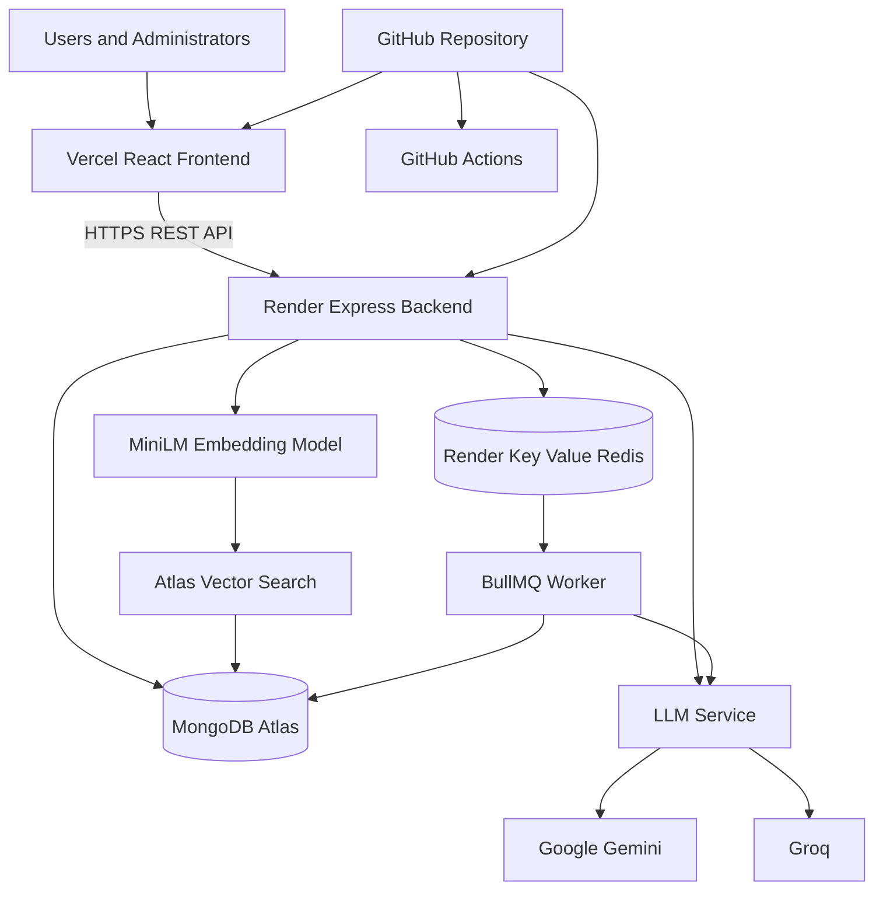
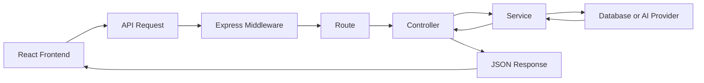
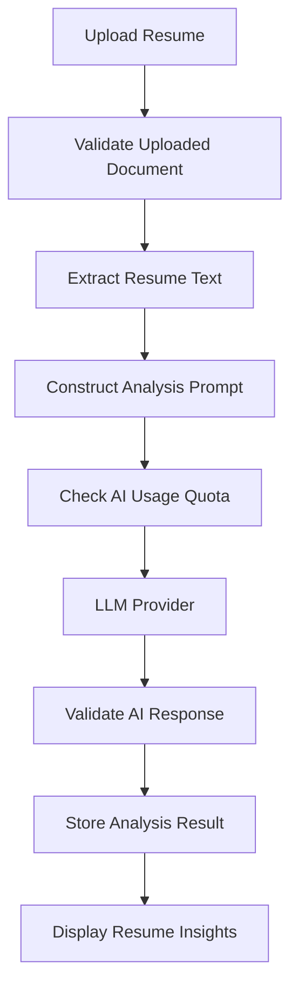
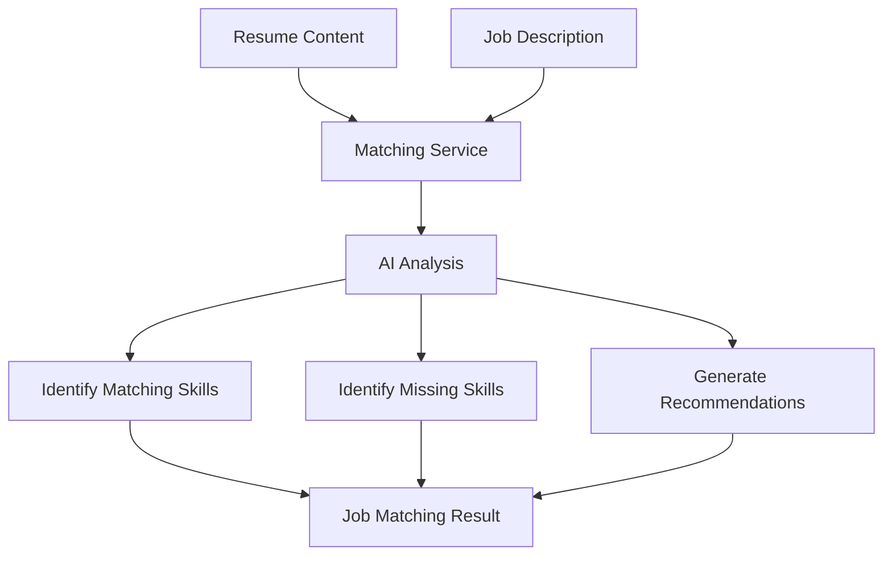
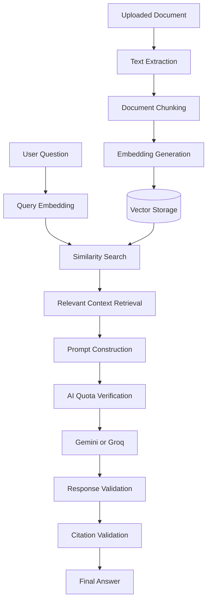
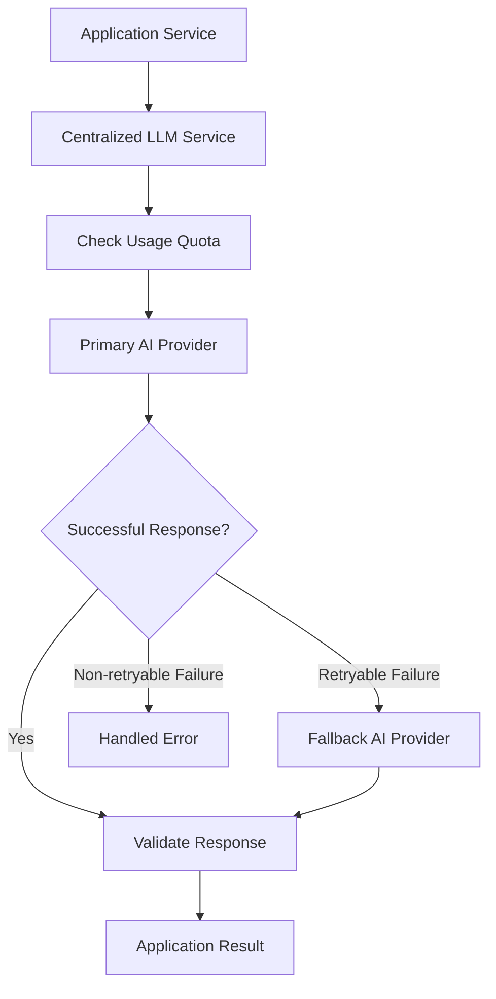
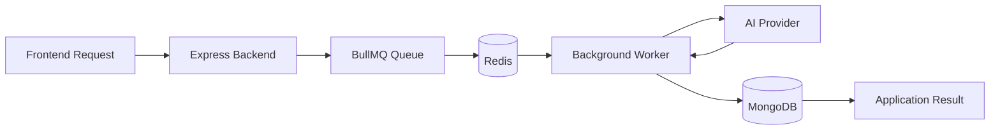
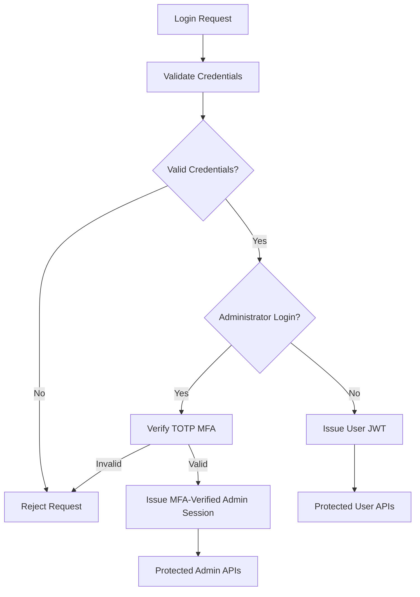
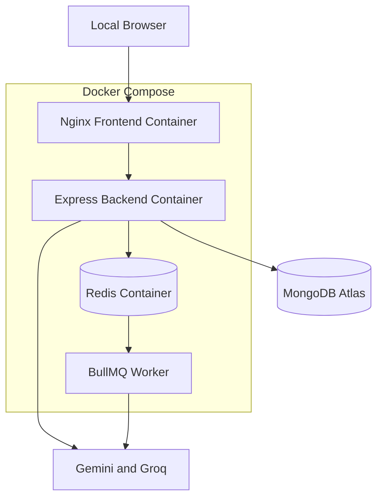
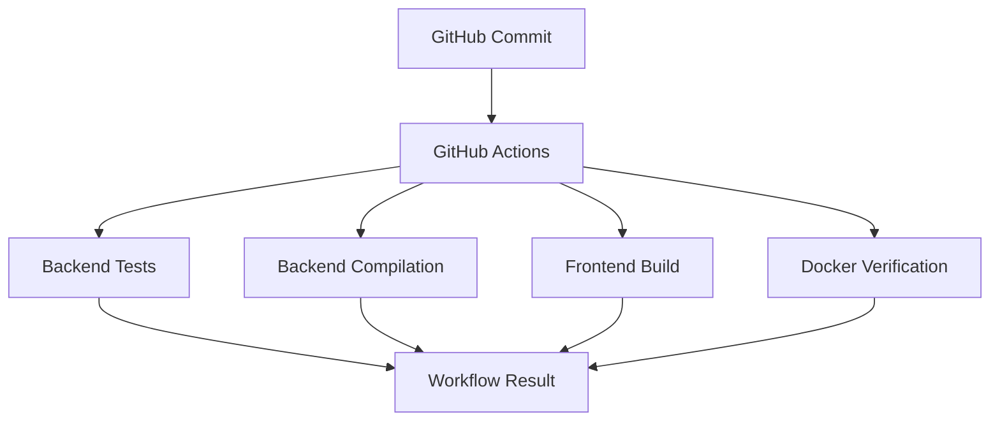

# CareerLens AI

### AI-Powered Career Intelligence & Resume Optimization Platform

[](https://ai-resume-analyzer-gtwt.vercel.app/)
[](https://github.com/Anshu2607/AI-Resume-Analyzer/actions)
[](https://www.typescriptlang.org/)

CareerLens AI is a full-stack career development platform designed for students, job seekers and professionals. It combines AI-powered resume analysis, retrieval-augmented generation (RAG), job matching, personalized career roadmaps and interview preparation into a unified platform.

The application also provides a dedicated administrative dashboard for user management, AI usage monitoring, analytics, audit logging and security oversight.

## Live Deployment

| Service | Link |
|---|---|
| Live Website | [CareerLens AI](https://ai-resume-analyzer-gtwt.vercel.app/) |
| Backend Service | [Render Backend](https://careerlens-ai-backend-w06e.onrender.com) |
| Source Code | [GitHub Repository](https://github.com/Anshu2607/AI-Resume-Analyzer) |
| CI Pipeline | [GitHub Actions](https://github.com/Anshu2607/AI-Resume-Analyzer/actions) |

> The application is deployed using free-tier cloud infrastructure. Initial requests may experience cold-start delays. Please use sample or anonymized resumes rather than confidential documents.

---

## Table of Contents

- [Problem Statement](#problem-statement)
- [Project Objectives](#project-objectives)
- [Key Features](#key-features)
- [Technology Stack](#technology-stack)
- [System Architecture](#system-architecture)
- [Core Application Workflows](#core-application-workflows)
- [RAG Architecture](#rag-architecture)
- [AI Integration](#ai-integration)
- [Redis and Background Processing](#redis-and-background-processing)
- [Authentication and Authorization](#authentication-and-authorization)
- [Security Implementation](#security-implementation)
- [Project Structure](#project-structure)
- [Local Installation](#local-installation)
- [Environment Configuration](#environment-configuration)
- [Docker Deployment](#docker-deployment)
- [Testing and CI](#testing-and-ci)
- [Cloud Deployment](#cloud-deployment)
- [Technical Challenges](#technical-challenges)
- [Current Limitations](#current-limitations)
- [Future Enhancements](#future-enhancements)
- [Security Reporting](#security-reporting)

---

## Problem Statement

Career preparation often requires individuals to use multiple independent platforms for resume analysis, job matching, skill development and interview preparation.

Traditional resume analysis tools frequently provide generic feedback without considering individual career goals or the contextual information contained within uploaded resumes.

CareerLens AI addresses this problem by integrating multiple AI-assisted career development workflows into a single platform.

It helps users identify resume weaknesses, understand job requirements, recognize skill gaps, prepare for interviews and develop personalized career learning plans.

The application is intended to support informed career decisions rather than guarantee employment or replace professional judgment.

---

## Project Objectives

- Provide personalized AI-powered career guidance.
- Analyze resumes and identify improvement opportunities.
- Evaluate resume compatibility with job descriptions.
- Identify missing technical and professional skills.
- Generate personalized career development roadmaps.
- Provide AI-powered interview practice and evaluation.
- Enable document-based question answering using RAG.
- Implement secure authentication and authorization.
- Provide administrative monitoring and management.
- Build a modular and extensible full-stack architecture.
- Deploy the application independently of local infrastructure.

---

## Key Features

### User Features

| Feature | Description |
|---|---|
| Resume Analysis | AI-powered resume evaluation and improvement recommendations |
| ATS Analysis | Heuristic ATS-oriented compatibility assessment |
| Job Matching | Comparison of resume content with job descriptions |
| Skill Gap Analysis | Identification of missing or relevant skills |
| Career Roadmap | Personalized learning and career development plans |
| Interview Preparation | AI-generated practice interview questions |
| Interview Evaluation | Answer evaluation and performance reports |
| RAG Assistant | Document-based question answering with citations |
| User Dashboard | Centralized access to career intelligence tools |
| Analysis History | Access to previously generated career insights |
| Authentication | Secure registration, login and account management |

### Administrator Features

- Dedicated administrator authentication.
- TOTP-based multi-factor authentication.
- Administrator dashboard and analytics.
- Registered user management.
- Account suspension and reactivation.
- AI usage monitoring.
- AI quota management.
- System health monitoring.
- User activity tracking.
- Administrative audit logs.
- Privacy management.
- Administrator session management.

---

## Technology Stack

### Frontend

| Technology | Purpose |
|---|---|
| React | Component-based user interface |
| TypeScript | Type safety and maintainability |
| Vite | Development server and production build |
| Tailwind CSS | Responsive interface styling |
| React Router | Client-side application routing |

### Backend

| Technology | Purpose |
|---|---|
| Node.js | Server-side JavaScript runtime |
| Express.js | REST API development |
| TypeScript | Type-safe backend implementation |
| Mongoose | MongoDB object modeling |
| Zod | Configuration and input validation |
| JWT | Token-based authentication |
| bcrypt | Password hashing |

### Database and Processing

| Technology | Purpose |
|---|---|
| MongoDB Atlas | Persistent application data |
| Redis | Caching, quotas, rate limiting and session-related state |
| BullMQ | Background job processing |
| MongoDB Atlas Vector Search | Semantic document retrieval |

### Artificial Intelligence

| Technology | Purpose |
|---|---|
| Google Gemini | AI text generation |
| Groq | Configurable language-model provider |
| Hugging Face Transformers | Local embedding generation |
| MiniLM | 384-dimensional document embeddings |
| RAG | Context-grounded document question answering |

### Infrastructure and DevOps

| Technology | Purpose |
|---|---|
| Docker | Application containerization |
| Docker Compose | Local multi-container orchestration |
| Nginx | Local reverse proxy |
| GitHub | Version control |
| GitHub Actions | Automated testing and build verification |
| Render | Backend and Redis hosting |
| Vercel | Frontend hosting |

### Testing and Security

- Vitest
- GitHub Actions
- GitHub Secret Scanning
- Dependabot
- JWT authentication
- Role-based access control
- TOTP multi-factor authentication
- Redis-backed rate limiting
- Environment-based secret management

---

## System Architecture

CareerLens AI follows a modular full-stack architecture in which frontend presentation, backend application logic, database operations, AI generation and background processing have separate responsibilities.

### Cloud Deployment Architecture



### Architecture Responsibilities

#### Frontend Layer

The React frontend provides user and administrator interfaces. It communicates with the backend using REST APIs and manages application routing, form interactions, loading states and authentication-related navigation.

#### Backend Layer

The Express backend handles authentication, authorization, request validation, business logic, AI integration and database communication.

The backend follows a modular structure consisting of routes, controllers, services, models, middleware and configuration modules.

#### Database Layer

MongoDB Atlas stores persistent application information, including user records, career-related results, conversations and administrative records.

Mongoose provides schema modeling and database interaction.

#### Redis Layer

Redis supports caching, distributed rate limiting, AI usage quotas, session-related state and background job coordination.

#### AI Layer

The AI layer coordinates language-model requests, provider selection, prompt construction, fallback behavior and response validation.

#### Background Processing Layer

BullMQ supports background processing, configurable worker concurrency, retry mechanisms and asynchronous job execution.

---

## Core Application Workflows

### REST API Request Flow



1. The user performs an action in the frontend.
2. The frontend sends an HTTP request to the backend.
3. Middleware validates authentication, request data and applicable limits.
4. The route forwards the request to the appropriate controller.
5. The controller delegates business logic to the service layer.
6. The service communicates with MongoDB, Redis or AI providers.
7. The backend returns a structured response.
8. The frontend displays the result.

### Resume Analysis Workflow



The resume analysis module extracts relevant resume content and uses structured AI prompts to generate feedback.

The analysis can include:

- Resume strengths.
- Improvement opportunities.
- Technical skill assessment.
- ATS-oriented compatibility estimates.
- Professional recommendations.

ATS-oriented scores are heuristic estimates and are not results from an actual employer's applicant tracking system.

### Job Matching Workflow



The application compares resume information with a target job description to identify relevant qualifications, missing skills and improvement opportunities.

### Career Roadmap Workflow

1. The application receives relevant career information.
2. The backend constructs a personalized roadmap prompt.
3. The language model generates structured career recommendations.
4. The response is validated and presented to the user.
5. The user can use the roadmap as a structured learning plan.

### Interview Preparation Workflow

1. The user selects an interview preparation context.
2. The application generates relevant interview questions.
3. The user submits answers.
4. AI-assisted evaluation provides feedback.
5. Interview performance reports summarize improvement opportunities.

---

## RAG Architecture

Retrieval-Augmented Generation improves document-based AI responses by retrieving relevant information before generating an answer.

Instead of relying entirely on the language model's general knowledge, the RAG pipeline provides relevant document content as additional context.

### RAG Execution Flow



### Document Processing

Uploaded documents are processed to extract textual information.

The extracted text is divided into smaller chunks so relevant sections can be retrieved independently.

### Embedding Generation

CareerLens AI uses a MiniLM embedding model through Hugging Face Transformers.

The model generates 384-dimensional numerical vectors representing semantic information contained within document chunks.

### Semantic Search

The user's question is converted into an embedding using the compatible embedding model.

Vector similarity retrieval identifies document chunks that are semantically relevant to the question.

Retrieval must remain scoped to the requesting user's authorized documents.

### Context Construction

Relevant document chunks are combined with the user's question and application instructions to construct the final language-model prompt.

### Response Generation

The configured language model generates an answer using the retrieved information.

### Citation Validation

The application validates supporting citation excerpts and can request corrective generation when citation validation fails.

Citation validation helps reduce unsupported references but does not guarantee factual correctness or eliminate hallucinations.

---

## AI Integration

CareerLens AI integrates Google Gemini and Groq through a configurable AI service architecture.

### Provider Architecture



### AI Integration Capabilities

- Configurable primary AI provider.
- Configurable fallback provider.
- Structured prompt generation.
- AI response validation.
- Provider error handling.
- AI usage tracking.
- Daily usage quota enforcement.
- Corrective generation for supported validation failures.

Provider fallback improves resilience when retryable provider failures occur. It does not guarantee availability when both providers are unavailable or usage limits are exceeded.

---

## Redis and Background Processing

Redis is used for application operations that benefit from fast access and shared state.

### Redis Responsibilities

- Application caching.
- Distributed rate limiting.
- AI quota counters.
- Session-related state.
- Token revocation records.
- BullMQ queue storage.

### BullMQ Responsibilities

- Background job coordination.
- Configurable worker concurrency.
- Retry and backoff configuration.
- Job lifecycle management.
- Completed and failed job retention.

### Background Processing Architecture



Interview-report generation is a documented background-processing workflow.

Additional job types are declared in the queue configuration, but declaration alone does not establish that every AI operation is processed asynchronously.

---

## Authentication and Authorization

### Authentication Flow



### User Authentication

- User registration.
- Password hashing.
- Credential validation.
- JWT generation.
- Protected routes.
- Account status verification.
- Session management.

### Administrator Authorization

Administrative APIs require multiple authorization checks:

1. Valid authentication token.
2. Administrator role.
3. Administrator session type.
4. Successful MFA verification.
5. Enabled administrator MFA status.

Authorization is enforced by the backend rather than relying solely on frontend route restrictions.

---

## Security Implementation

CareerLens AI implements multiple application and repository security controls.

### Application Security

| Security Control | Purpose |
|---|---|
| Password Hashing | Prevent plaintext password storage |
| JWT Authentication | Authenticate API requests |
| Role-Based Access Control | Restrict administrative functionality |
| TOTP MFA | Strengthen administrator authentication |
| MFA Secret Encryption | Protect enrolled MFA secrets |
| Session Invalidation | Restrict outdated or invalid sessions |
| Token Revocation | Prevent reuse of revoked tokens |
| Account Suspension | Restrict suspended accounts |
| Rate Limiting | Reduce excessive request activity |
| Input Validation | Reject invalid application inputs |
| CORS | Restrict permitted browser origins |
| Security Headers | Improve HTTP security |
| AI Quotas | Restrict excessive AI usage |
| Audit Logging | Track administrative actions |
| Environment Validation | Prevent unsafe startup configuration |

### Repository Security

- Private environment files are excluded from Git.
- Public environment templates contain placeholders.
- GitHub Secret Scanning detects supported exposed credentials.
- Dependabot monitors known dependency vulnerabilities.
- GitHub Actions validates application builds and tests.
- Previously exposed credentials were rotated.
- Affected Git history was rewritten.

Push protection and additional security scanning options should be enabled where available.

Never commit:

- MongoDB credentials.
- Gemini or Groq API keys.
- JWT signing secrets.
- Redis passwords.
- MFA encryption keys.
- Authentication tokens.
- Private environment files.

These controls do not constitute an independent security audit or guarantee that the application is free of vulnerabilities.

For vulnerability reporting, refer to [SECURITY.md](SECURITY.md).

---

## Project Structure

```text
CareerLens-AI/
│
├── .github/
│   └── workflows/
│
├── backend/
│   ├── src/
│   │   ├── config/
│   │   ├── controllers/
│   │   ├── middleware/
│   │   ├── models/
│   │   ├── prompts/
│   │   ├── queues/
│   │   ├── routes/
│   │   ├── services/
│   │   ├── utils/
│   │   ├── validators/
│   │   ├── workers/
│   │   ├── app.ts
│   │   └── server.ts
│   │
│   ├── tests/
│   ├── .env.example
│   ├── Dockerfile
│   ├── package.json
│   └── tsconfig.json
│
├── frontend/
│   ├── src/
│   │   └── admin/
│   ├── public/
│   ├── Dockerfile
│   ├── vercel.json
│   ├── package.json
│   └── vite.config.ts
│
├── .github/
├── .gitignore
├── .env.production.example
├── docker-compose.yml
├── DEPLOYMENT.md
├── SECURITY.md
└── README.md
```

The structure above summarizes the main application components rather than listing every source file.

### Backend Folder Responsibilities

| Folder | Responsibility |
|---|---|
| config | Runtime, database, Redis and application configuration |
| controllers | HTTP request and response handling |
| middleware | Authentication, authorization and validation |
| models | MongoDB schemas |
| prompts | AI prompt definitions |
| queues | BullMQ queue management |
| routes | REST API route definitions |
| services | Business logic and AI integration |
| utils | Shared utility functions |
| validators | Input validation schemas |
| workers | Background job processing |
| tests | Automated application tests |

---

## Local Installation

### Prerequisites

Ensure the following tools and services are available:

- Git.
- Node.js.
- npm.
- Docker Engine or Docker Desktop.
- Docker Compose.
- MongoDB Atlas account and cluster.
- Gemini and/or Groq API credentials.
- Compatible Atlas Vector Search index for RAG.

The project's Docker and CI environments use Node.js 24.

### Clone the Repository

```bash
git clone https://github.com/Anshu2607/AI-Resume-Analyzer.git
```

```bash
cd AI-Resume-Analyzer
```

### Install Backend Dependencies

```bash
cd backend
npm ci
```

### Install Frontend Dependencies

From the repository root:

```bash
cd frontend
npm ci
```

---

## Environment Configuration

Create private environment files using the sanitized example files provided in the repository.

For Windows PowerShell, run the following from the repository root if the backend environment file does not already exist:

```powershell
if (!(Test-Path backend/.env)) {
    Copy-Item backend/.env.example backend/.env
}
```

Populate the environment variables using your own credentials.

### Backend Environment Variables

| Variable | Purpose |
|---|---|
| PORT | Backend server port |
| NODE_ENV | Runtime environment |
| DEPLOYMENT_MODE | Deployment configuration |
| CLIENT_URL | Permitted frontend origin |
| TRUSTED_PROXY | Trusted proxy configuration where required |
| MONGODB_URI | MongoDB database connection |
| JWT_SECRET | JWT signing secret |
| JWT_EXPIRES_IN | Token expiration configuration |
| GEMINI_API_KEY | Gemini authentication |
| GEMINI_MODEL | Gemini model selection |
| GROQ_API_KEY | Groq authentication |
| GROQ_MODEL | Groq model selection |
| LLM_PROVIDER | Primary AI provider |
| LLM_FALLBACK_PROVIDER | Alternative AI provider |
| LLM_FALLBACK_ENABLED | Provider fallback configuration |
| EMBEDDING_MODEL | Embedding model configuration |
| EMBEDDING_DIMENSIONS | Vector dimensions |
| REDIS_HOST | Redis hostname |
| REDIS_PORT | Redis port |
| REDIS_PASSWORD | Redis authentication |
| REDIS_DB | Redis database number |
| QUEUE_PREFIX | Queue namespace |
| QUEUE_WORKER_CONCURRENCY | Worker concurrency |
| QUEUE_JOB_ATTEMPTS | Job retry attempts |
| QUEUE_BACKOFF_DELAY | Retry backoff configuration |
| ADMIN_MFA_ENCRYPTION_KEY | MFA secret encryption |
| ADMIN_MFA_ENROLLMENT_ENABLED | Administrator MFA enrollment control |
| AI_QUOTA_ENABLED | AI quota enforcement |
| AI_USAGE_TRACKING_ENABLED | AI usage monitoring |
| ACTIVITY_TRACKING_ENABLED | User activity monitoring |
| HF_HOME | Embedding model cache location |
| LOG_LEVEL | Application logging configuration |

Production JWT secrets must satisfy the application's minimum security requirements.

The MFA encryption key must contain exactly 64 hexadecimal characters. Preserve the existing encryption key when using previously enrolled administrator accounts.

Configure the remaining queue retention and runtime variables according to the environment templates and deployment documentation.

### Frontend Environment Variable

The deployed frontend uses:

```env
VITE_API_BASE_URL=https://careerlens-ai-backend-w06e.onrender.com/api/v1
```

For standalone local frontend development, configure the reachable local backend API address instead.

Frontend variables prefixed with VITE_ are public build-time configuration. Never use them to store backend credentials.

---

## Docker Deployment

CareerLens AI supports a Docker Compose-based local deployment.

### Docker Architecture



### Build Docker Images

From the project root:

```bash
docker compose build
```

### Start Application

```bash
docker compose up -d
```

### Verify Containers

```bash
docker compose ps
```

### Open Application

http://localhost:3000

### View Backend Logs

```bash
docker compose logs --tail=50 backend
```

### Monitor Resource Consumption

```bash
docker stats --no-stream
```

### Stop Application

```bash
docker compose stop
```

Stopping the containers does not delete their configured persistent volumes.

### Docker Advantages

- Reproducible application environment.
- Service isolation.
- Consistent dependency configuration.
- Private container networking.
- Persistent local volumes.
- Simplified local application startup.

---

## Testing and CI

CareerLens AI uses automated tests and GitHub Actions to validate application changes.

### Backend Tests

From the repository root:

```bash
cd backend
npm ci
npm run test
```

Tests should use isolated test configurations rather than production database credentials.

### Backend Build

```bash
cd backend
npm run build
```

### Frontend Build

From the repository root:

```bash
cd frontend
npm ci
npm run build
```

### GitHub Actions Workflow



The CI workflow validates:

- Backend automated tests.
- Backend TypeScript compilation.
- Frontend production build.
- Docker image verification.

The deployed application has also undergone functional testing by the project maintainer, including user authentication, administrator MFA, resume analysis, job matching, career roadmaps, interview preparation and RAG.

These tests do not represent exhaustive security or performance coverage.

View the latest results:

[GitHub Actions](https://github.com/Anshu2607/AI-Resume-Analyzer/actions)

---

## Cloud Deployment

The application is deployed across managed cloud services.

| Component | Hosting Platform |
|---|---|
| React Frontend | Vercel |
| Express Backend | Render |
| Redis | Render Key Value |
| MongoDB | MongoDB Atlas |
| Gemini | Google AI |
| Groq | Groq Cloud |
| Source Control | GitHub |

### Render Backend Configuration

| Setting | Value |
|---|---|
| Runtime | Docker |
| Branch | main |
| Root Directory | backend |
| Dockerfile | Dockerfile |
| Docker Build Context | . |
| Deployment Mode | cloud |
| Runtime Environment | production |

Production credentials are configured through Render environment variables.

The MongoDB Atlas network access list must permit the backend's applicable outbound IP ranges.

The Render Redis service is configured using internal connectivity and authentication.

### Vercel Frontend Configuration

| Setting | Value |
|---|---|
| Framework | Vite |
| Root Directory | frontend |
| Install Command | npm ci |
| Build Command | npm run build |
| Output Directory | dist |

### Production API Configuration

```env
VITE_API_BASE_URL=https://careerlens-ai-backend-w06e.onrender.com/api/v1
```

### Production Frontend Origin

```env
CLIENT_URL=https://ai-resume-analyzer-gtwt.vercel.app
```

The backend requires a valid HTTPS origin without a trailing slash.

### SPA Routing

The frontend includes Vercel rewrite configuration in:

```text
frontend/vercel.json
```

This allows direct navigation and refresh on React client-side routes, including administrator and dashboard pages.

### Deployment Benefits

- Public access independent of the development laptop.
- Managed HTTPS endpoints.
- GitHub-integrated deployments.
- Cloud-hosted application services.
- Centralized environment configuration.

Local Docker containers do not need to be running to access the deployed application.

For additional deployment details, refer to [DEPLOYMENT.md](DEPLOYMENT.md).

---

## Technical Challenges

Several real-world engineering problems were encountered and resolved during development.

| Problem | Resolution |
|---|---|
| MongoDB DNS timeout | Removed hardcoded DNS override and improved connection diagnostics |
| Incorrect database selection | Restored the correct database name in the MongoDB URI |
| Nginx 502 Bad Gateway | Diagnosed backend startup failures and restored service connectivity |
| RAG embedding cache permissions | Configured writable cache storage and Docker volumes |
| Invalid RAG citations | Improved citation validation and corrective response handling |
| Credential exposure | Rotated credentials, sanitized templates and rewrote affected Git history |
| Git SSL certificate failure | Configured Windows certificate verification and resolved network connectivity |
| Render environment validation | Corrected production environment values |
| Invalid frontend origin | Configured the exact HTTPS frontend origin |
| MongoDB cloud connectivity | Configured Atlas network access for Render |
| Vercel build failure | Corrected the installation command |
| Incorrect API URL | Configured the correct production API base URL |
| Vercel route 404 | Added SPA rewrite configuration |

These challenges provided practical experience with application debugging, distributed services, deployment configuration, cloud networking and security engineering.

---

## Current Limitations

CareerLens AI is currently deployed as a free-tier portfolio demonstration rather than a high-availability production service.

### Hosting Limitations

- Render may suspend inactive free-tier services.
- Cold starts can delay initial requests.
- CPU and memory resources are limited.
- The cloud filesystem may be ephemeral.
- AI provider usage is subject to configured quotas and service limits.

### Data and Reliability Limitations

- Free Redis-compatible storage may lose state during restarts.
- Queue durability and quota counters require stronger persistence for business-critical use.
- Token revocation and rate-limit state require durable infrastructure for stronger security guarantees.
- Persistent cloud file storage requires additional planning.
- Peak workload capacity has not been independently established.

### AI Limitations

- AI-generated responses may contain inaccuracies.
- ATS compatibility scores are heuristic estimates.
- Citation validation reduces unsupported references but does not eliminate hallucinations.
- AI recommendations should be reviewed by users.

Additional production verification of trusted proxy handling, JWT expiration, rate limiting and restart behavior remains appropriate before claiming enterprise-grade security or reliability.

---

## Future Enhancements

- Durable Redis infrastructure.
- Cloud object storage for uploaded files.
- Dedicated background worker services.
- Horizontal backend scaling.
- Advanced monitoring and observability.
- Automated production deployment gates.
- Comprehensive load and stress testing.
- Enhanced tenant-isolation testing.
- Improved RAG evaluation and retrieval quality.
- Advanced interview analytics.
- Additional career personalization capabilities.

These are proposed improvements and are not presented as currently implemented features.

---

## Security Reporting

If you discover a potential security vulnerability, please report it responsibly using the guidance provided in:

[SECURITY.md](SECURITY.md)

Do not disclose real credentials, authentication tokens, confidential resumes or private user information in public GitHub issues.

---

## Project Status

- Full-stack application implemented.
- AI and RAG features integrated.
- Administrator dashboard implemented.
- Docker containerization completed.
- GitHub CI pipeline configured.
- Backend deployed on Render.
- Frontend deployed on Vercel.
- Major deployed workflows functionally tested.
- Additional production hardening documented.

---

## Author

Developed as a full-stack AI-powered career intelligence and resume optimization project.

The project demonstrates practical implementation of:

- Full-stack web development.
- REST API architecture.
- Generative AI integration.
- Retrieval-Augmented Generation.
- Database design.
- Redis and asynchronous processing.
- Authentication and authorization.
- Application security.
- Docker containerization.
- CI/CD workflows.
- Cloud deployment.

---

## License

CareerLens AI is an educational and portfolio project.

Review the repository's applicable licensing terms, if any, before redistribution or commercial reuse.

---

### CareerLens AI

AI-powered career intelligence for smarter career preparation.

[Visit Live Website](https://ai-resume-analyzer-gtwt.vercel.app/)